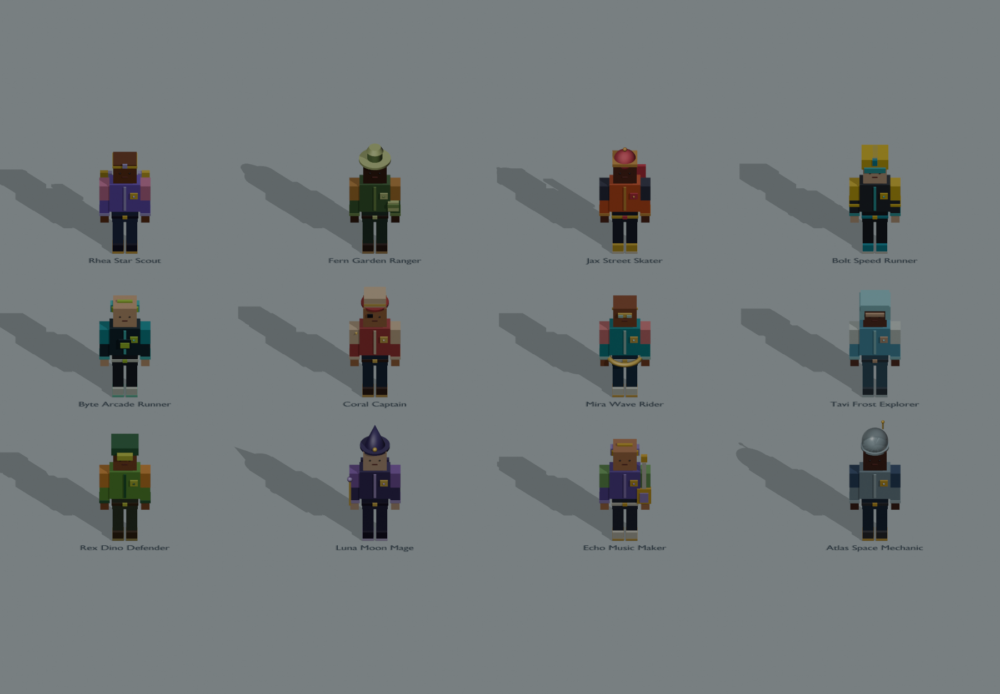

# Character roster

The roster currently has 13 block-style characters. `roster.json` records their
sequence, roles, and GLB paths. The sequence is a suggested discovery order for
the story; character IDs and filenames stay stable if the order changes.

| # | Character | Story seed | GLB |
| ---: | --- | --- | --- |
| 01 | Milo the Rookie Builder | Starter builder and first friend | [GLB](milo_rookie.glb) |
| 02 | Rhea Star Scout | Trailblazer | [GLB](roster/rhea_star_scout.glb) |
| 03 | Fern Garden Ranger | Woodland guide | [GLB](roster/fern_garden_ranger.glb) |
| 04 | Jax Street Skater | Town shortcut finder | [GLB](roster/jax_street_skater.glb) |
| 05 | Bolt Speed Runner | Race leader | [GLB](roster/bolt_speed_runner.glb) |
| 06 | Byte Arcade Runner | Arcade tinkerer | [GLB](roster/byte_arcade_runner.glb) |
| 07 | Coral Captain | Harbor navigator | [GLB](roster/coral_captain.glb) |
| 08 | Mira Wave Rider | Shoreline explorer | [GLB](roster/mira_wave_rider.glb) |
| 09 | Tavi Frost Explorer | Mountain guide | [GLB](roster/tavi_frost_explorer.glb) |
| 10 | Rex Dino Defender | Brave guardian | [GLB](roster/rex_dino_defender.glb) |
| 11 | Luna Moon Mage | Gentle spell-caster | [GLB](roster/luna_moon_mage.glb) |
| 12 | Echo Music Maker | Music inventor | [GLB](roster/echo_music_maker.glb) |
| 13 | Atlas Space Mechanic | Machine fixer | [GLB](roster/atlas_space_mechanic.glb) |

## Build and manage

- [Character build guide](CHARACTER_BUILD_GUIDE.md) — environment, editing,
  creation, export, and ordering.
- [Ordered roster manifest](roster.json) — machine-readable IDs, sequence,
  story roles, and model paths.
- [Milo's Sand3D source](milo_rookie.py) — the first character example.
- [Shared Sand3D builder](build_roster.py) — source for the other 12 characters.

Rebuild from the workspace root:

```powershell
.\.venv\Scripts\python.exe assets\characters\milo_rookie.py
.\.venv\Scripts\python.exe assets\characters\build_roster.py
```


